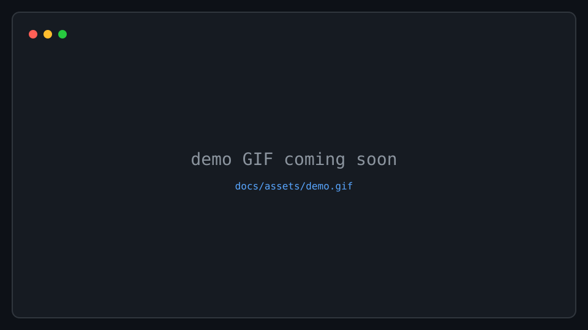
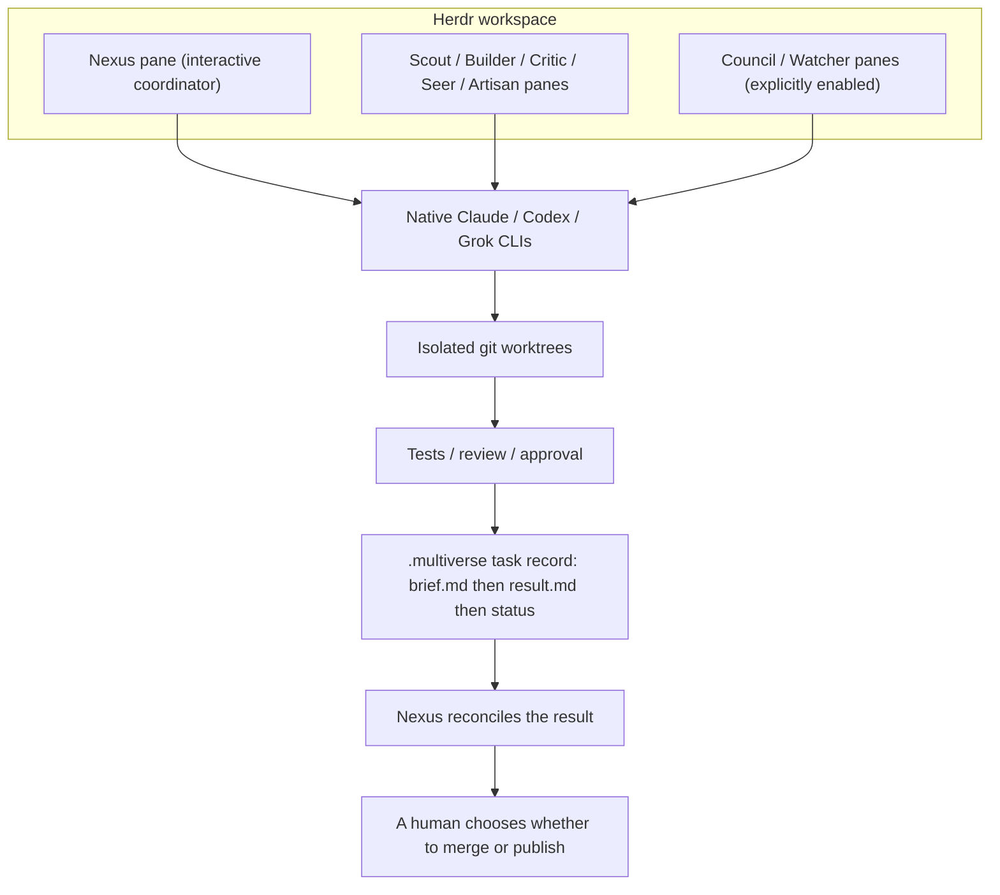

# Herdr Multiverse

[](https://github.com/BamBam4275/herdr-multiverse/actions/workflows/ci.yml)
[](https://github.com/BamBam4275/herdr-multiverse/releases)
[](#license)
[](CONTRIBUTING.md#msrv-policy)

**A single Rust binary that coordinates Claude, Codex, and Grok through
isolated Herdr worktrees — one binary, native vendor CLIs, no API-key
proxy.**



A real `docs/assets/demo.gif` of the orchestration flow will replace the
placeholder above before the first public release.

## Features

- **Cross-vendor orchestration** — route work to Claude, Codex, and Grok
  from one fleet, without a shared API-key proxy.
- **Isolated git worktrees** — every implementation task runs in its own
  worktree, so parallel work can't collide on the same files.
- **Role-based routing** — work is dispatched to named roles with explicit
  write scopes (see [Roles](#roles) below), not an open-ended agent loop.
- **Explicit review and approval gates** — destructive or quota-consuming
  actions require an explicit flag; nothing escalates silently.
- **Durable task/result trail** — every task leaves a brief, a result, and
  a status file on disk as its own audit trail.

## Status

Herdr Multiverse is a **pre-1.0 rewrite**, preparing for its first tagged
release (`v0.1.0`). It is a from-scratch Rust port of a Python reference
implementation, built so the two can be checked against each other for
behavioral parity before the Rust binary becomes the only implementation.

What is on this tree today:

- Seven crates (`mv-core`, `mv-config`, `mv-herdr`, `mv-state`,
  `mv-engine`, `mv-board`, `mv-cli`) and a `multiverse` binary, all with
  real implementations — none of the seven is a module-list stub.
- Clap parsing for 28 subcommands, exit codes 0/1/2/3, and `--yes`
  authorization on `dispatch` / `council`.
- 1978 crate unit/integration tests passing
  (`cargo test --workspace --all-features --locked`; counted as the
  sum of every `test result: … passed` line from `cargo test -j 4`).
- A 154-scenario conformance harness under `conformance/` that replays
  identical CLI invocations through this binary and the frozen Python
  reference and diffs exit code, stdout/stderr, and the resulting
  `.multiverse/` files; all 154 currently pass against Rust
  (`python3 conformance/run_all.py`).
- `conformance/diff_fuzz.py`, a seeded differential fuzzer: random
  write sequences plus a fixed battery of read probes after each
  write (`board`, `tasks`, `dispatch --dry-run` for Scout / Builder /
  Critic, and others) compared against the frozen Python oracle.
  Four `dispatch --dry-run` rendering differences are accepted and
  folded before comparison: agent short-codes and prompt-file names
  follow the role rename; appended prompt-file line counts differ;
  the `WOULD RUN` pane-command section is this binary's own real
  runner; and prompt wrapping is a width artifact that can split a
  sandbox path mid-string. Any other `--dry-run` divergence still
  fails the comparison.
- On one machine, warm `board --all --read-only --no-reconcile
  --no-color` is 4.56 s after the task-event index, and warm
  `sweep --stale-only` went from 6.94 s to 2.50 s after caching the
  mail index and skipping extra routing-log walks. Those figures are
  a single-host measurement, not a performance guarantee.
- History compatibility: task directories, routing-log entries, and
  `board`/`result`/`tasks`/`worktrees` output written under the retired
  role names (`orchestrator`, `explorer`, `fixer`, `librarian`,
  `reviewer`, `oracle`, `designer`, `observer`) still read correctly —
  see [`docs/roles.md`](docs/roles.md#legacy-on-disk-names) for the
  mapping. All seven `history-*` conformance scenarios pass.
- Directory-trust handling for the two agent kinds that need it before a
  seat can start: Codex's `trust_level = "trusted"` is written into that
  seat's `CODEX_HOME/config.toml` automatically, immediately before launch
  (`crates/mv-engine/src/codex_trust.rs`); Claude's own one-time "do you
  trust the files in this folder?" dialog is not automated — it is
  detected and left for a human to accept once per project, naming the
  pane rather than typing into it (`crates/mv-engine/src/runner.rs`'s
  `attention_reason`); a live `dispatch --yes` that lands on one refuses
  with a non-zero exit naming the pane, rather than reporting a
  successful dispatch.
- A Herdr client, `fake-herdr`, routing log, task/brief rendering,
  embedded prompts/skills, Nexus seeds, config loading and validation,
  comment-preserving config edits, a one-shot role-key config migrator, a
  fleet halt/sweep maintenance tick, an effective review-policy
  inspector, and the conformance harness itself.

What is real but short of full Python parity, specifically:

- `multiverse start` opens a live Nexus pane through
  `mv-engine::fleet_start`, not a placeholder, and `--reseed` on an
  already-open project now re-points that live session (dialog/blocked
  detection, agent-identity-by-name matching, retry-with-probe landing
  confirmation) rather than only rewriting the seed file. The
  project-level concurrency lock around check-then-create, the Claude
  deny-list launch wrapper (`mv-engine::trust::claude_orchestrator_launch`),
  and the dashboard tab (`--dashboard`) are all ported now; the remaining
  scope cuts are the per-role dispatch-availability table in the seed
  (rendered empty rather than claiming availability it hasn't checked)
  and Python's exact agent-naming scheme (seats are named
  `<project>-nexus` instead); see
  `crates/mv-cli/src/commands/start.rs`'s own module doc for the
  complete list.
- `multiverse council --yes` seats a real roster and convenes it through
  `mv-engine::council::convene` against the real Herdr runner, not a
  refusal — a missing `--yes` seats the roster and prints it before
  refusing, rather than refusing generically. Scope cuts: no live
  `agent list` probe while seating (a capped seat always reads as full),
  `accounts prefer` reordering isn't applied to the council chain, and a
  convened council's per-seat result lines aren't rendered, only the
  aggregate tally (`crates/mv-cli/src/commands/council.rs`).
- `multiverse dispatch --yes` drives the real
  `mv-engine::runner::dispatch` against the real Herdr runner, not a
  refusal; `--dry-run`'s planner (seat selection, breaker state,
  degrade/fallback policy, the printed plan) is real and
  conformance-tested too. `--into` lane adoption, a bounded
  `lane_setup` timeout, and real breaker trial claims are all wired now;
  the remaining scope cuts are agent-name minting's 32-char/blake2
  budget (not ported byte-for-byte) and a partial task-id collision
  rebind (`crates/mv-cli/src/commands/dispatch.rs`). Landing a dispatch's
  first prompt now confirms the brief was actually submitted, not just
  pasted: `deliver_prompt` requires either a `Working` agent or the brief
  no longer sitting in the pane's own composer region before declaring it
  landed, sends at most one bare Enter (never the brief again) if the
  window closes with it still unsubmitted and the agent reads idle, and
  fails the dispatch loudly rather than leaving a silent idle lane
  (`deliver_prompt` / `confirm_submitted` / `prompt_still_in_composer` in
  `crates/mv-engine/src/runner.rs`).

See [`CHANGELOG.md`](CHANGELOG.md) for what has shipped release by
release, and [`docs/architecture.md`](docs/architecture.md) for crate
and command maps. Expect breaking changes between pre-1.0 releases.

## Requirements

- [Herdr](https://herdr.dev/tui/docs/) installed and on your `PATH`.
- At least one supported vendor CLI already installed and authenticated
  (Claude, Codex, or Grok) — Multiverse starts these as native
  subprocesses and never handles their API keys itself.
- No Rust toolchain required to install a release binary; a Rust
  toolchain is only needed to build from source (see
  [Install](#install) below).

## Install

The primary install path is through Herdr's plugin manager, which fetches a
prebuilt, checksummed release binary — no Rust toolchain required. Replace
`vX.Y.Z` with a published tag whose release notes cover the commands you
need:

```sh
herdr plugin install BamBam4275/herdr-multiverse --ref vX.Y.Z --yes
```

For local development against a checkout instead of a release:

```sh
herdr plugin link /absolute/path/to/herdr-multiverse
```

`herdr plugin link` skips the plugin's build hook, so build the binary
yourself first (see [Building from source](#building-from-source)).

### Building from source

```sh
cargo build --release --locked -p mv-cli
```

### Full install reference

See [`docs/install.md`](docs/install.md) for platform-specific steps,
release asset naming, plugin actions, and troubleshooting a failed build
hook. That page also records that packaging checks do not mean fleet
commands are ready for production.

## Quick start

1. Install or link the plugin (above), or run the binary from
   `target/release/multiverse`.
2. Confirm the parser is alive. This does not consume quota:

   ```sh
   multiverse --help
   multiverse --version
   ```

3. Try a read-only command against your own `config.toml`, such as
   `multiverse doctor`, `multiverse check`, or `multiverse board`.
   `dispatch` and `council` without `--yes` or `--dry-run` exit 1 naming
   the flag; `dispatch --dry-run` plans a real dispatch (seat selection,
   breaker/degrade policy) without spending quota. Retired `--role`
   names such as `fixer` exit 3.

4. Plugin actions (`multiverse-doctor`, `multiverse-board`,
   `multiverse-start`, and the rest listed in
   [`docs/install.md`](docs/install.md)) invoke the same binary.
   `multiverse-start` opens a live Nexus pane (see [Status](#status)
   above for its scope cuts), and `dispatch`/`council` are deliberately
   absent from the plugin action menu — both spend subscription quota,
   which a manifest action should never do silently. See
   [Status](#status) above for the exact gaps before treating a plugin
   install as a complete port of the Python fleet.

## Configuration

Configuration lives under Herdr's own plugin config directory
(`HERDR_PLUGIN_CONFIG_DIR`), never inside the managed plugin checkout.
The plugin wrapper requires a readable `config.toml` there before it will
exec the binary. The minimum intended shape, matching
[`config.example.toml`](config.example.toml), is one account, one role,
and one project chain:

```toml
# config.toml (redacted example — fill in your own account names)
[accounts.claude]
kind = "claude"
config_dir_var = "CLAUDE_CONFIG_DIR"
config_dir = "<<PLACEHOLDER: absolute path to the Claude config dir>>"
pool = "claude"
available = true

[roles.scout]
write_scope = "none"
[roles.scout.models]
claude = "<<PLACEHOLDER: model id>>"

[projects.example]
path = "<<PLACEHOLDER: absolute path to the project root>>"
[projects.example.chains]
scout = ["claude"]
```

The loader honors `<<PLACEHOLDER: ...>>` values (never guessing at
one), and `multiverse config migrate` rewrites retired role keys in
place, preserving comments, with a timestamped backup. See
[`docs/configuration.md`](docs/configuration.md) for file locations,
environment variables, roster overrides, and the migration command.
Upgrading from the Python reference? See
[`docs/migrating-from-python.md`](docs/migrating-from-python.md).

## Roles

Roles are process boundaries, not model promises. The actual vendor CLI,
account, model, quota, write scope, and approval policy come from
configuration; no role silently broadens its scope.

| Role | Purpose | Default interaction | Writes / side effects | Escalates to |
|---|---|---|---|---|
| **Nexus** | Long-lived coordinator and task router | Reads project/config state; starts explicit role work in Herdr panes | Orchestration metadata, briefs, routing log; may open panes; must not silently spend quota or modify a worktree | Human; Council; Critic |
| **Scout** | Fast codebase reconnaissance; returns a map, not file contents | Read-only vendor CLI in the target worktree | Result and status only | Nexus |
| **Builder** | Implement a scoped, already-decided change in an isolated worktree | Vendor CLI with the task worktree as cwd | Only the brief's write scope | Critic, then Nexus |
| **Archivist** | External knowledge retrieval (library docs, APIs, web) | Read-only network/docs lookup | Result and status only | Nexus |
| **Critic** | Adversarial, cross-vendor review of another agent's work | Read-only review of the Builder worktree plus test/log output | Result and status only; never the code under review | Council or Nexus |
| **Seer** | Architecture, risk, and hard debugging | Read-only analysis of the brief | Result and status only; never implements its recommendation | Nexus |
| **Council** | High-stakes multi-vendor decision support | Explicit `multiverse council` (requires `--yes`) | Highest quota; result and status only; no automatic code changes | Nexus |
| **Artisan** | UI/UX design and the edits that implement it | Designs and ships scoped presentation changes | Files the brief names; nothing on a review card | Critic, then Nexus |
| **Watcher** | Visual and media analysis (images, PDFs, diagrams) | Read-only inspection of the named media | Result and status only | Nexus |

`--role` accepts `scout`, `builder`, `archivist`, `critic`, `seer`,
`council`, `artisan`, `watcher`. Nexus is not a `--role`; it is launched
by `start`. History already on disk still reads the retired names
(`orchestrator`, `explorer`, `fixer`, `librarian`, `reviewer`, `oracle`,
`designer`, `observer`). See [`docs/roles.md`](docs/roles.md) for the full
contract, including that mapping.

## How it works



Three invariants hold regardless of implementation detail:

- Native vendor authentication stays inside each CLI; Multiverse never
  receives or proxies an API key.
- Builders get their own worktree; no two roles write the same files at
  the same time.
- The task/result/status files on disk are provenance, not a hidden
  message bus — anything a role decided is readable after the fact.

See [`docs/architecture.md`](docs/architecture.md) for the crate-level
breakdown, the command inventory, and the design decisions behind this
shape.

## Security and permissions

- Herdr plugins are ordinary user code; Herdr does not sandbox them.
  Installing this plugin gives its build hook and binary your local user
  permissions.
- Multiverse does not receive or proxy Claude/Codex/Grok API keys. It
  starts the native vendor CLIs, which own their own authentication — but
  it can still inherit environment variables and reach any repository,
  process, or network resource available to your user.
- Read-only actions (`multiverse-doctor`, `multiverse-board`, status
  inspection) only inspect config, task records, and pane state.
  Write-capable actions create or update task records, open panes,
  create worktrees, send prompts to vendor CLIs, or run tests/builds —
  see the [Roles](#roles) table for which role does which. `start` opens
  a real pane; see [Status](#status) for its scope cuts short of full
  Python parity.
- Council is explicit because it can start several vendor processes at
  once and consume multiple quota pools simultaneously. `dispatch` and
  `council` require `--yes` (or `--dry-run`) before either reaches its
  handler — `dispatch` without either prints the generic "requires
  --yes" refusal, while a missing `--yes` on `council` seats the real
  roster and prints it before refusing. `dispatch --yes` and
  `council --yes` each drive a real run, each with scope cuts (see
  [Status](#status)).
- Configuration and runtime state live in Herdr-provided directories
  (`HERDR_PLUGIN_CONFIG_DIR`, `HERDR_PLUGIN_STATE_DIR`), never inside the
  managed plugin checkout.
- See [`SECURITY.md`](SECURITY.md) to report a vulnerability.

## FAQ

**Does it need Rust?**
No, if you install via `herdr plugin install` — that fetches a prebuilt
binary. Rust is only needed to build from source.

**Which CLIs/accounts must already be installed?**
At least one of Claude, Codex, or Grok's native CLI, already authenticated.
Multiverse starts them as subprocesses; it does not install or authenticate
them for you.

**Does it send API keys to Herdr?**
No. Multiverse never receives or proxies vendor API keys; each native CLI
owns its own authentication.

**What is written?**
Task briefs, results, and status files under each project's `.multiverse/`
directory, plus any files a dispatched role's write scope names (typically
an isolated git worktree). See [Security and permissions](#security-and-permissions).
`dispatch --yes` and `start` both perform these writes for real today,
each with scope cuts short of full Python parity — see [Status](#status).

**How do I update/uninstall?**
Use Herdr's own plugin update/uninstall flow
(`herdr plugin update` / `herdr plugin uninstall`); see
[`docs/install.md`](docs/install.md) for details and what state, if any,
survives.

**Can I run one role only?**
Yes — dispatch targets a specific role and task; nothing requires running
the full role set. `dispatch --dry-run` plans and prints the real seat
selection for one role/task; `dispatch --yes` actually runs it, with the
scope cuts noted in [Status](#status).

**What happens if a vendor CLI is unavailable?**
A configuration error (exit code 3), not a silent vendor swap: when every
account in a role's chain is unavailable, `dispatch --dry-run` refuses
and names each seat's reason rather than routing around the chain. A
chain with at least one available entry falls back to it and reports the
skip (`conformance/scenarios/dispatch-fallback-unavailable.json`,
`dispatch-chain-exhausted.json`).

## Contributing

See [`CONTRIBUTING.md`](CONTRIBUTING.md) for build/test commands, commit
conventions, and PR expectations, and
[`CODE_OF_CONDUCT.md`](CODE_OF_CONDUCT.md) for community standards. Bug
reports and feature requests use the templates under
[`.github/ISSUE_TEMPLATE/`](.github/ISSUE_TEMPLATE/).

## License

Licensed under either the [MIT license](LICENSE-MIT) or the
[Apache License, Version 2.0](LICENSE-APACHE), at your option.

## Acknowledgements

- [Herdr](https://herdr.dev/tui/docs/), the terminal multiplexer and plugin
  host this project is built on.
- [oh-my-opencode-slim](https://github.com/alvinunreal/oh-my-opencode-slim),
  acknowledged for inspiring this project's role taxonomy.
