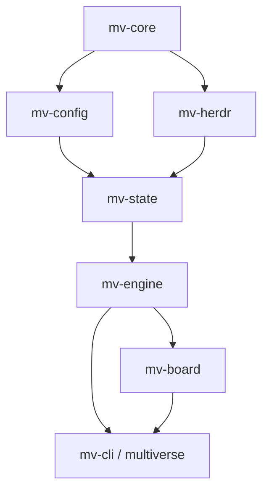

# Architecture

Herdr Multiverse is a single, sync Rust binary (`multiverse`) that replaces
a Python reference implementation while keeping its on-disk formats and exit
codes byte-stable. This page describes the workspace layout, the runtime
model, the CLI surface as it exists in this tree, and the design decisions
that shape it.

The rewrite is pre-1.0. Clap parsing, library modules, packaging, and the
conformance harness are present, and most command handlers are real.
Live (`--yes`) `dispatch`, a live Nexus-pane launch for `start`, and
live (`--yes`) `council` all now drive the real `mv-engine::runner`
against Herdr, each with documented scope cuts short of full Python
parity (see each command's own module doc and the table below). See the
README's [Status](../README.md#status) section for the exact boundary.
Treat the module and command tables below as a map of what is on disk,
not a promise that every command runs a fleet end to end.

## Workspace layout

The workspace is split into seven crates, chosen to isolate *dependencies*
(`toml_edit`, `ratatui`, `clap`, subprocess handling) rather than to mirror
the Python module boundaries one-to-one. Parallel contributors own *files
inside* a crate; none of them need to edit another crate's public module
list to add their own code.

Arrows are the one-way crate DAG. Crates also depend on lower layers
directly: `mv-engine` on `mv-config` and `mv-herdr`; `mv-board` on
`mv-state` and `mv-core`; `mv-cli` on `mv-board`, `mv-engine`, `mv-config`,
and `mv-core`. There is no `tokio` dependency.

| Crate | Owns | Does not own |
|---|---|---|
| `mv-core` | Exit codes, typed-error leaves, task identifiers, file locking, atomic write-then-rename, timestamp formatting, redaction, CRC32 checksums | Herdr client code, TOML schema, CLI parsing |
| `mv-config` | Loading and validating `config.toml`/`roster.toml`, placeholder handling, config append semantics, one-shot role-key migrations | Dispatch policy |
| `mv-herdr` | Argv construction for every Herdr subcommand, JSON envelope parsing, subprocess execution, the `HERDR_BIN_PATH` override, a `fake-herdr` binary for tests | Fleet locking, task records |
| `mv-state` | Everything under a project's `.multiverse/` directory: routing log and index, task directories, worktrees, scratch panes, activity, backlog, mail | Starting Herdr agents directly |
| `mv-engine` | Role selection, dispatch planning, the task runner, council coordination, prompt/skill embedding, usage and quota tracking | CLI argument parsing, terminal rendering |
| `mv-board` | The plain-text board renderer and the `ratatui`-based `--watch` view | Writing files |
| `mv-cli` | `clap` argument parsing, command dispatch, the single exception-to-exit-code boundary | Business logic |

### Module layout

Wave 0 closed each crate's `lib.rs` module list. Implementations fill those
files; they do not add new modules by editing another lane's `lib.rs`. Every
module below is implemented today — none of the seven crates has a
remaining module-list-only stub.

| Crate | Modules (`src/*.rs`) | Notes |
|---|---|---|
| `mv-core` | `atomic`, `crc32`, `error`, `exit`, `id`, `lock`, `redact`, `secure_open`, `time` | Implemented |
| `mv-config` | `edit`, `error`, `load`, `migrate`, `placeholder`, `roles`, `roster` | Implemented |
| `mv-herdr` | `argv`, `envelope`, `error`, `run`, `shapes`, plus `bin/fake-herdr.rs` | Implemented |
| `mv-state` | `activity`, `backlog`, `breaker_store`, `gauge`, `halt`, `hostsleep_store`, `index`, `log`, `mail`, `notify`, `nudge_memory`, `paths`, `scratch`, `seatstate_store`, `tasks`, `worktrees` | Implemented |
| `mv-engine` | `breaker`, `brief`, `codex_trust`, `codex_worktree_permissions`, `council`, `directives`, `dispatch`, `dockerreport`, `fleet_start`, `gateway`, `grok_usage`, `health`, `hostsleep`, `lane_diff`, `limits`, `nexus_seed`, `prompts`, `risk_paths`, `runner`, `seatstate`, `selector`, `skills`, `sweep_nudges`, `trust`, `usage` | Implemented as libraries. `runner`/`council`/`fleet_start` are all now called from `mv-cli` (`dispatch --yes`, `council --yes`/`--dry-run`, `start`/`stop`) — see [Commands](#commands) below |
| `mv-board` | `accounts`, `card`, `columns`, `layout`, `render`, `status_cards`, `watch` | Implemented |
| `mv-cli` | `args`, `commands`, `exit`, `main` | Parsing, authorization, and exit mapping implemented. Every command handler calls real library code, each with its own documented scope cuts short of full Python parity (see the table below and each handler's own module doc) |

## Commands

`multiverse` requires a subcommand. Global `--config PATH` is accepted on
the root command and on every leaf. `dispatch` and `council` refuse to run
without `--yes` or `--dry-run` (exit 1, naming the flag) before they reach
their handler. Unknown `--role` values, including the retired names and
`nexus`, exit 3. Usage errors from clap exit 2. Help and `--version` exit 0.

`--role` accepts the worker keys `scout`, `builder`, `archivist`, `critic`,
`seer`, `council`, `artisan`, `watcher`. Nexus is launched by `start`, not
by `--role`. `council` is also a dedicated subcommand.

The table below is the clap surface and what each handler actually does
today. "Real" means the handler reads/writes real state and is covered by
its own module's tests (several also have a pinned conformance scenario);
it does not mean every flag of that command is implemented, only that the
command is not a blanket stub. Every command below is real; several rows
note scope cuts short of full Python parity rather than a missing CLI
binding — see each one's own module doc for the complete list.

| Command | Purpose | Status |
|---|---|---|
| `dispatch` | Scoped task to a worker; execution requires `--yes` | Real: `--dry-run` reports the plan (seat selection, breaker/degrade policy); `--yes` drives the real `mv-engine::runner::dispatch` against `ProcessHerdr`, including `--into` lane adoption, a bounded `lane_setup` timeout, and real breaker trial claims (see `commands::dispatch`'s own module doc for what is not yet ported to full Python parity: agent-name minting's exact byte budget, and a partial task-id collision rebind) |
| `halt on\|off\|status` | Fleet halt | Real |
| `scratch open\|read\|close` | Isolated scratch panes | Real |
| `start` | Start Nexus for selected projects | Real: opens a live Nexus pane through `mv-engine::fleet_start`, and `--reseed` on an already-open project now re-points its live session (dialog/blocked detection, orchestrator-identity-by-name matching, retry-with-probe landing confirmation) (see `commands::start`'s own module doc for what is not yet ported to full Python parity: the project-level concurrency lock, the Claude deny-list launch wrapper, the dashboard tab, the per-role dispatch-availability table, and Python's exact agent-naming scheme) |
| `projects` | List configured projects | Real |
| `stop` | Stop project sessions | Real |
| `add` | Register an existing project | Real (plain-text append, not yet through `mv-config::edit`) |
| `new` | Create, register, and start a project | Real for create/register; its final `start` step shares `start`'s scope cuts above |
| `tasks` | Inspect or update project tasks | Real for listing/reconcile/`--close-stranded`/`--reclaimable`/`--supersede`/`--acknowledge` (each a dry run by default, `--yes` to write); Python's unattended, lease-expiry-gated auto-supersede pass (`converge_stale`) is not ported anywhere in this workspace (`commands::tasks`'s own module doc) |
| `board` | One-shot text board; `--watch` is reserved for the interactive view | Real |
| `council` | Ask Council; execution requires `--yes` | Real: a missing `--yes` seats the roster and prints it before refusing; `--yes` convenes every seated seat through `mv-engine::council::convene` against `ProcessHerdr` (see `commands::council`'s own module doc for scope cuts: no live `agent list` probe while seating, `accounts prefer` reordering not applied, per-seat result lines not rendered) |
| `accounts` | List accounts, or `trip` / `reset` / `limit` / `usage` / `lend` / `prefer` | Real |
| `seat show` | Inspect an account seat | Real |
| `worktrees` | Inspect, prune, rescue, or restore task worktrees | Real |
| `check` | Readiness (exit 0 ready, 3 needs configuration) | Real |
| `doctor` | Installation prerequisites (exit 0 pass, 1 fail) | Real |
| `presence` | Operator presence (exit 2 if unknown) | Real; always reports `unknown` — no idle-probe exists yet |
| `health` | Fleet health | Real |
| `review-policy` | Effective review policy | Real |
| `sweep` | Inspect and maintain fleet state | Real |
| `notify` | Queue or flush operator notifications | Real |
| `inspect` | Inspect project context | Real |
| `result` | Read a task result | Real |
| `activity` | `send` / `reply` / `close` / `broadcast` / `nudge` / `inbox` / `update` | Real for all seven: `nudge` types Python's exact `NUDGE_PROMPT` into each permitted recipient's live orchestrator pane and confirms it landed, through the same `FleetState::orchestrator_agent` / `deliver_prompt_to` pair `start --reseed` uses, but does not reproduce Python's fine-grained reached/unconfirmed/unverifiable/unreached split or its composer-text/dialog-menu pane-read checks (`commands::activity`'s own module doc) |
| `backlog` | `add` / `list` / `done` / `reopen` / `annotate` / `reprioritize` / `show` / `ask` / `mark-asked` / `answer` | Real |
| `directives set\|show` | Standing project directives | Real |
| `workers` | List worker sessions | Real |
| `config migrate` | One-shot role-key rewrite, dry-run or in place with backup | Real |

`activity inbox` takes `--as-nexus` (help text: authorize acknowledging as
the Nexus); `--as-orchestrator` is rejected outright, not accepted as an
alias — release policy. The handler honors it: a process carrying a
dispatched task id (`MULTIVERSE_TASK_ID`) never advances the read cursor
on a plain read, matching Python's "a specialist must never advance the
orchestrator's own mail read" rule, unless `--as-nexus` is passed.
`--replay-since SEQ` / `--replay-last N` re-show past mail through
`mv_state::activity::replay_inbox` without ever touching the cursor; both
are refused together with each other, with `--peek`, or with `--as-nexus`.

Plugin actions in `herdr-plugin.toml` invoke the same binary:
`multiverse-doctor`, `multiverse-check`, `multiverse-accounts`,
`multiverse-tasks`, `multiverse-board`, `multiverse-start`,
`multiverse-workers`, and the `dashboard` pane (`board --all --watch
--read-only`). `multiverse-start` shares `start`'s scope cuts above.
`dispatch` and `council` are deliberately absent from the action list.
See [`docs/install.md`](install.md) for the install path.

## Runtime model

Herdr Multiverse is **synchronous**. It maps `subprocess`-style execution to
`std::process::Command`, maps file locking to a blocking `flock`, and uses a
small, bounded thread pool only where the reference implementation already
used threads (starting a handful of agent seats in parallel). There is no
`tokio` dependency in the workspace.

The reason is structural, not a style preference: the fleet lock is held
*across* a Herdr subprocess call in several code paths. An async runtime
that awaits while holding that lock either blocks its own executor or needs
`spawn_blocking` around every call that matters. If Herdr's CLI ever becomes
too slow for interactive use, the fix is a bounded thread pool inside the
Herdr client, not an async workspace.

## Exit codes

Four exit codes are preserved from the reference implementation and are
part of the stable contract scripts can depend on:

| Code | Meaning |
|---|---|
| `0` | Success, including an honest no-op |
| `1` | Operation failed |
| `2` | Usage error, or an inconclusive presence check |
| `3` | Configuration problem that needs a human decision, not a crash |

`mv-cli` maps clap usage to 2, unknown `--role` to 3, and missing `--yes`
on `dispatch`/`council` to 1. Library
crates return typed errors (`thiserror`); only `mv-cli` converts an error
into a process exit code and a printed message. Herdr's own exit codes
and JSON error envelopes are never reinterpreted as Multiverse's own exit
status.

Doctor stays 0/1. Check stays 0/3.

## Prompts, skills, and templates

`mv-engine`'s `build.rs` walks `prompts/` and `templates/` at compile time
and embeds each file with `include_str!`. A missing `prompts/` or
`templates/` directory fails the build. A missing role file is a runtime
`MissingPromptError` looked up as `role-{key}.md` (and `column-{column}.md`
for stages). Old on-disk role names are not aliases on this path: `--role
fixer` is unknown, and the shipped files live under the new keys.

At runtime, `MULTIVERSE_PROMPTS_DIR` / `MULTIVERSE_TEMPLATES_DIR`, a
`prompts/` or `templates/` directory next to the executable (or two levels
up, for a plugin `bin/` layout), or `HERDR_PLUGIN_ROOT` override the
embedded copy so a live edit does not need a rebuild. `Prompt::body`
splits on the first `\n---\n`. Skill grants keep the `*` / `!name` / `!*` /
`[]` algebra; denial wins.

Nexus seeds keep the historical filename `.multiverse/orchestrator.md` so
existing projects resume in place. The renderer is `mv-engine::nexus_seed`.

## Packaging and distribution

Herdr Multiverse ships as a Herdr plugin with a `[[build]]` hook that:

1. Reuses an already-installed, version-matching binary if one exists.
2. Downloads a checksummed release binary for the detected OS/architecture
   from a GitHub Release.
3. Falls back to `cargo build --release` if a release asset isn't available
   but `cargo` is.
4. Fails loudly, naming the missing toolchain or release, if neither works.

`herdr plugin link` (used for local development) skips the build hook
entirely, so contributors build with `cargo` directly. See
[`CONTRIBUTING.md`](../CONTRIBUTING.md) for the exact commands, and
[`docs/install.md`](install.md) for end-user install steps.

## Conformance testing

The Python reference implementation is the frozen specification until
cutover. A harness under `conformance/` runs identical scenarios through
both binaries against a fake Herdr executable (`HERDR_BIN_PATH`) and
compares exit code, stdout/stderr, and the resulting `.multiverse/` files
on disk (`python3 conformance/run_all.py`), including history-reader
scenarios for retired role names. See the install guide's
[verification reference](install.md#verification-and-troubleshooting)
for current passing test and scenario counts, and the
[Python/Rust parity reference](parity.md) for the flag-by-flag comparison.
A deliberate behavioral drift in a wired-up command is expected to fail
this harness. Narrower unit tests live next to the parsers and stateful
logic they cover.

## Design decisions we rejected

- **An async (`tokio`) runtime** — see [Runtime model](#runtime-model)
  above.
- **A crate per source module**, mirroring the Python file layout —
  parallelism in this project comes from file ownership within a crate, not
  from crate count, and a crate-per-module split would serialize the
  dependency graph.
- **A daemon-and-database architecture** — Multiverse is a CLI that shells
  out to vendor CLIs and `git`; it has no need for a persistent daemon or an
  embedded database.
- **`cargo build` as the only install path** — that would require every
  user to have a Rust toolchain; a prebuilt, checksummed release binary is
  the primary install path instead.
- **A TUI renderer for the one-shot `board` command** — one-shot output
  stays plain, parseable text so it keeps working as a plugin action
  output and in scripts; `ratatui` is reserved for the interactive
  `--watch` mode.

## See also

- [`docs/roles.md`](roles.md) — the role contracts this architecture
  dispatches work to.
- [`docs/configuration.md`](configuration.md) — how configuration and state
  are loaded and migrated.
